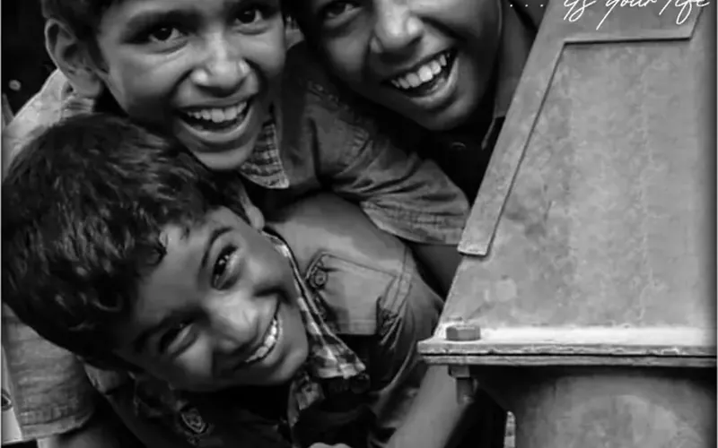

<a href="https://kodialex.com">
  <picture>
    <source media="(prefers-color-scheme: dark)" srcset="assets/banner-dark.svg">
    
  </picture>
</a>

I design products and then build them myself. M.Sc. in UX & Data-Driven Design at SRH Berlin, B.Tech in AI & Machine Learning before that. Most of what I make starts in Figma and ends up live.

[**kodialex.com**](https://kodialex.com) · [LinkedIn](https://www.linkedin.com/in/kodialex) · [rockzzalex1@gmail.com](mailto:rockzzalex1@gmail.com) · [my contact card](https://kodialex.com/contact)

---

### 🌸 csakura

<a href="https://github.com/realstrawhat/csakura"></a>

A cherry tree that grows in your terminal. A new tree every run, falling petals, wind, 15 palettes. C and ncurses. [](https://github.com/realstrawhat/csakura/stargazers)

```sh
brew install realstrawhat/csakura/csakura   # macOS
yay -S csakura                               # Arch
nix run github:realstrawhat/csakura          # Nix
```

[Play with it in your browser →](https://kodialex.com/project-csakura)

---

### Other things I've made

<table>
<tr>
<td width="50%" valign="top">
<a href="https://kodialex.com/project-food-ai"></a><br>
<b><a href="https://kodialex.com/project-food-ai">Food AI</a></b><br>
Snap a meal, get its ingredients, calories and a recipe. Runs on a local model (Gemma 3 via Ollama).
</td>
<td width="50%" valign="top">
<a href="https://kodialex.com/project-hate-speech"></a><br>
<b><a href="https://kodialex.com/project-hate-speech">Hate speech classifier</a></b><br>
Five models, 19,826 tweets. 89.84% accuracy that was quietly missing most of the hate speech, and what I did about it.
</td>
</tr>
<tr>
<td width="50%" valign="top">
<a href="https://kodialex.com/project-tech-revive"></a><br>
<b><a href="https://github.com/realstrawhat/E-waste-app">ReCycle</a></b><br>
E-waste drop-offs and pickups in Flutter. Won our SIH internal hackathon, then I rebuilt it properly.
</td>
<td width="50%" valign="top">
<a href="https://kodialex.com/project-mind-well"></a><br>
<b><a href="https://kodialex.com/project-mind-well">Mind Well</a></b><br>
A mood journal with playlists and audiobooks, built by four of us in 12 hours. 1st place, Hack Infinity 2K24.
</td>
</tr>
<tr>
<td width="50%" valign="top">
<a href="https://kodialex.com/project-smile-always"></a><br>
<b><a href="https://kodialex.com/project-smile-always">Smile Always Foundation</a></b><br>
A charity website with programme pages and online donations. Designed and built solo.
</td>
<td width="50%" valign="top">
<a href="https://kodialex.com/project-aadarana"></a><br>
<b><a href="https://kodialex.com/project-aadarana">Aadarana Trust</a></b><br>
Website for children's homes in Hyderabad, with a Razorpay donation flow. Next.js, solo.
</td>
</tr>
</table>

---

**Tools I reach for:** Figma · HTML/CSS/JS · React · Next.js · Flutter · Node.js · C · Python · PyTorch · scikit-learn · Ollama

Looking for Werkstudent roles and internships in UX and front-end in Berlin. [Say hi](mailto:rockzzalex1@gmail.com).
