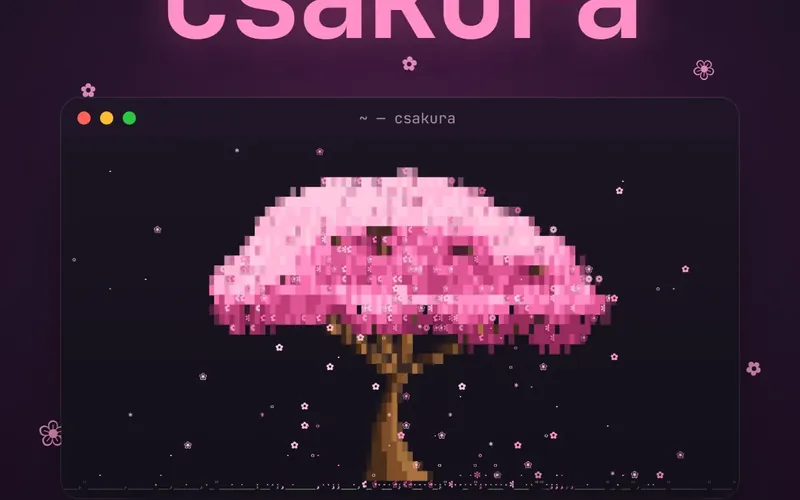
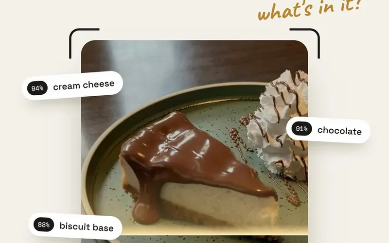
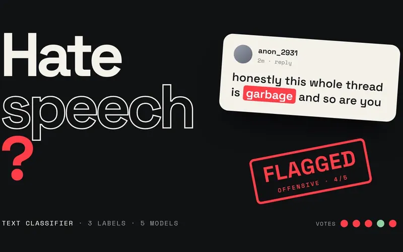
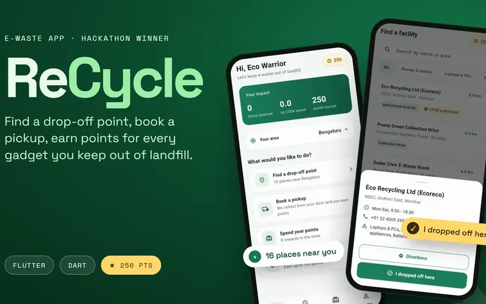
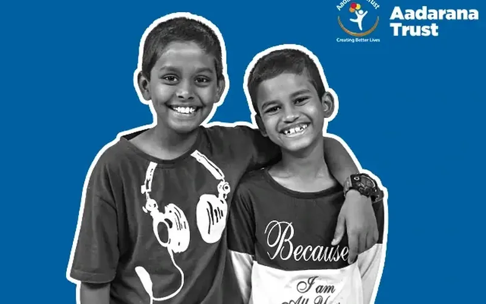

<a href="https://kodialex.com">
  <picture>
    <source media="(prefers-color-scheme: dark)" srcset="assets/banner-dark.svg">
    
  </picture>
</a>

```console
$ whoami
kodi alex · designs it, then ships it · berlin

$ brew install realstrawhat/csakura/csakura
🌸 a cherry tree grows in your terminal
```

<table>
<tr>
<td width="33%"><a href="https://github.com/realstrawhat/csakura"></a></td>
<td width="33%"><a href="https://kodialex.com/project-food-ai"></a></td>
<td width="33%"><a href="https://kodialex.com/project-hate-speech"></a></td>
</tr>
<tr>
<td><a href="https://kodialex.com/project-tech-revive"></a></td>
<td><a href="https://kodialex.com/project-mind-well"></a></td>
<td><a href="https://kodialex.com/project-aadarana"></a></td>
</tr>
</table>

[](https://github.com/realstrawhat/csakura) **[kodialex.com](https://kodialex.com)** · [LinkedIn](https://www.linkedin.com/in/kodialex) · [say hi](mailto:rockzzalex1@gmail.com)
