<a href="https://kodialex.com"><picture><source media="(prefers-color-scheme: dark)" srcset="assets/banner-dark.svg"></picture></a>

<b>1</b> · Decorated frames

<b>2</b> · Contact sheet

<b>3</b> · Kinetic type

<b>4</b> · Film strip

<b>5</b> · Swiss motion poster

<a href="https://kodialex.com"><b>kodialex.com</b></a> · <a href="https://www.linkedin.com/in/kodialex">LinkedIn</a> · <a href="mailto:rockzzalex1@gmail.com">say hi</a>

